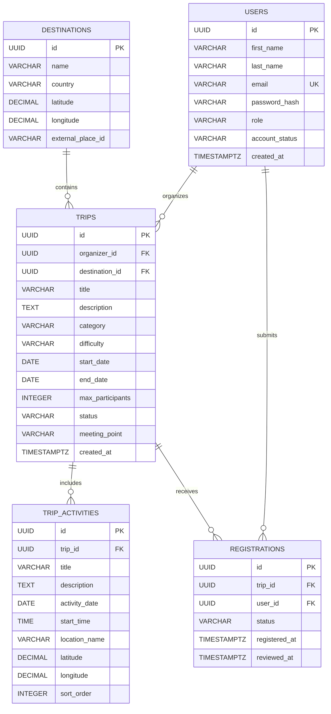

# 3. Podatkovni model – TripHarbor

## 3.1 Izbira podatkovne baze

Za shranjevanje podatkov bo uporabljena relacijska podatkovna baza **PostgreSQL**.

Relacijski podatkovni model je primeren za aplikacijo TripHarbor, saj vsebuje več medsebojno povezanih entitet, kot so uporabniki, izleti, destinacije, aktivnosti in prijave na izlete.

PostgreSQL omogoča uporabo primarnih in tujih ključev, omejitev ter transakcij, ki zagotavljajo celovitost in doslednost podatkov. Podatkovni model je zasnovan tako, da podpira funkcionalnosti prve različice (MVP) in omogoča kasnejše razširitve. V zalednem delu aplikacije Node.js bo za dostop do podatkovne baze uporabljen Prisma ORM, ki omogoča definiranje modelov, povezav in migracij.

## 3.2 Glavne entitete in njihova polja

### 1. Users – uporabniki

Entiteta `users` hrani podatke o registriranih uporabnikih in njihovih vlogah.

| Polje | Podatkovni tip | Opis |
|---|---|---|
| id | UUID, PK | Enolični identifikator uporabnika |
| first_name | VARCHAR(100) | Ime uporabnika |
| last_name | VARCHAR(100) | Priimek uporabnika |
| email | VARCHAR(255), UNIQUE | Enolični e-poštni naslov |
| password_hash | VARCHAR(255) | Varno zgoščeno geslo |
| role | VARCHAR(20) | Vloga: PARTICIPANT, ORGANIZER ali ADMIN |
| account_status | VARCHAR(20) | Status računa: ACTIVE ali SUSPENDED |
| created_at | TIMESTAMPTZ | Datum in čas registracije |

Vsak uporabnik ima določeno vlogo, na podlagi katere sistem preverja njegove pravice. Ob registraciji dobi vlogo `PARTICIPANT`, administrator pa mu lahko na zahtevo dodeli vlogo `ORGANIZER`. Status `SUSPENDED` je predviden za kasnejšo administrativno nadgradnjo.

### 2. Destinations – destinacije

Entiteta `destinations` vsebuje podatke o geografskih destinacijah izletov.

| Polje | Podatkovni tip | Opis |
|---|---|---|
| id | UUID, PK | Enolični identifikator destinacije |
| name | VARCHAR(150) | Ime kraja ali območja |
| country | VARCHAR(100) | Država |
| latitude | DECIMAL(9,6) | Geografska širina |
| longitude | DECIMAL(9,6) | Geografska dolžina |
| external_place_id | VARCHAR(255), NULL | Identifikator lokacije iz zunanje geografske storitve |

Destinacije omogočajo iskanje izletov po krajih in njihov prikaz na interaktivnem zemljevidu. Geografski podatki se lahko pridobijo prek zunanje storitve za geokodiranje.

### 3. Trips – izleti

Entiteta `trips` predstavlja posamezen organiziran skupinski izlet ali potovanje.

| Polje | Podatkovni tip | Opis |
|---|---|---|
| id | UUID, PK | Enolični identifikator izleta |
| organizer_id | UUID, FK | Organizator izleta (`users.id`) |
| destination_id | UUID, FK | Glavna destinacija (`destinations.id`) |
| title | VARCHAR(200) | Naslov izleta |
| description | TEXT | Podroben opis izleta |
| category | VARCHAR(50) | Kategorija izleta |
| difficulty | VARCHAR(20) | Zahtevnost: EASY, MODERATE ali CHALLENGING |
| start_date | DATE | Datum začetka izleta |
| end_date | DATE | Datum zaključka izleta |
| max_participants | INTEGER | Največje dovoljeno število udeležencev |
| status | VARCHAR(20) | DRAFT, PENDING, PUBLISHED, REJECTED ali CANCELLED |
| meeting_point | VARCHAR(255) | Opis zbirnega mesta |
| created_at | TIMESTAMPTZ | Datum in čas ustvarjanja |

Vsak izlet ima enega organizatorja in eno glavno destinacijo. Organizator lahko ustvari več izletov, na isti destinaciji pa je lahko organiziranih več različnih izletov.

Status izleta določa, ali je izlet še v pripravi, čaka na odobritev, je javno objavljen, zavrnjen ali odpovedan.

### 4. Trip_activities – aktivnosti izleta

Entiteta `trip_activities` vsebuje aktivnosti, ki sestavljajo program posameznega izleta.

| Polje | Podatkovni tip | Opis |
|---|---|---|
| id | UUID, PK | Enolični identifikator aktivnosti |
| trip_id | UUID, FK | Povezava na izlet (`trips.id`) |
| title | VARCHAR(200) | Naziv aktivnosti |
| description | TEXT | Opis aktivnosti |
| activity_date | DATE | Datum aktivnosti |
| start_time | TIME, NULL | Predvideni čas začetka |
| location_name | VARCHAR(255) | Ime lokacije |
| latitude | DECIMAL(9,6), NULL | Geografska širina lokacije |
| longitude | DECIMAL(9,6), NULL | Geografska dolžina lokacije |
| sort_order | INTEGER | Vrstni red aktivnosti v programu |

Posamezen izlet lahko vsebuje več aktivnosti. Aktivnosti so razvrščene po datumu, času in vrstnem redu, kar omogoča prikaz dnevnega programa izleta.

### 5. Registrations – prijave na izlete

Entiteta `registrations` predstavlja prijave uporabnikov na posamezne izlete.

| Polje | Podatkovni tip | Opis |
|---|---|---|
| id | UUID, PK | Enolični identifikator prijave |
| trip_id | UUID, FK | Povezava na izlet (`trips.id`) |
| user_id | UUID, FK | Prijavljeni uporabnik (`users.id`) |
| status | VARCHAR(20) | PENDING, ACCEPTED, REJECTED ali CANCELLED |
| registered_at | TIMESTAMPTZ | Datum in čas oddaje prijave |
| reviewed_at | TIMESTAMPTZ, NULL | Datum in čas odločitve organizatorja |

Entiteta `registrations` povezuje uporabnike in izlete. Posamezen uporabnik se lahko prijavi na več izletov, posamezen izlet pa lahko prejme več prijav.

Kombinacija polj `trip_id` in `user_id` bo enolična, kar preprečuje podvojene prijave istega uporabnika na isti izlet.

## 3.3 Povezave med entitetami

| Povezava | Kardinalnost | Opis |
|---|---|---|
| Users → Trips | 1 : N | En organizator lahko ustvari več izletov. |
| Destinations → Trips | 1 : N | Ena destinacija je lahko povezana z več izleti. |
| Trips → Trip_activities | 1 : N | En izlet lahko vsebuje več aktivnosti. |
| Users → Registrations | 1 : N | En uporabnik lahko odda več prijav. |
| Trips → Registrations | 1 : N | En izlet lahko prejme več prijav. |
| Users ↔ Trips (prek Registrations) | M : N | Več uporabnikov se lahko prijavi na več izletov. |

## 3.4 Osnutek podatkovnega modela

Naslednji ER-diagram prikazuje glavne entitete, njihove ključne atribute in medsebojne povezave.

## 3.5 Omejitve in celovitost podatkov

Za pravilno delovanje sistema bodo upoštevana naslednja pravila:

- **Enoličnost uporabnikov:** vsak e-poštni naslov je lahko povezan samo z enim uporabniškim računom.
- **Enoličnost prijav:** posamezen uporabnik ima lahko samo eno prijavo na posamezen izlet. Če uporabnik po preklicu ponovno odda prijavo, backend posodobi obstoječi zapis iz `CANCELLED` v `PENDING` namesto ustvarjanja novega zapisa. Ponovna prijava po zavrnitvi (`REJECTED`) ni samodejno dovoljena.
- **Omejitev kapacitete:** število prijav s statusom `ACCEPTED` ne sme preseči vrednosti `max_participants`. Backend bo to preverjal znotraj podatkovne transakcije ob potrditvi prijave. Pri sočasnih potrditvah bo uporabljen ustrezen mehanizem za preprečevanje tekmovalnih pogojev (npr. transakcija z ustrezno izolacijo in ponovnim poskusom).
- **Veljavnost datumov:** datum zaključka izleta ne sme biti pred datumom začetka. Datum aktivnosti mora biti znotraj trajanja izleta.
- **Pozitivna kapaciteta:** vrednost `max_participants` mora biti večja od nič.
- **Preverjanje vlog:** izlet lahko ustvari samo uporabnik z vlogo `ORGANIZER`, javno objavo pa lahko odobri samo `ADMIN`.
- **Prijava na izlet:** uporabnik se lahko prijavi samo na izlet s statusom `PUBLISHED`, če je prijava še odprta.
- **Referenčna integriteta:** tuji ključi zagotavljajo, da so povezani zapisi v podatkovni bazi veljavni.
- **Omejitve na ravni baze:** enoličnost e-poštnih naslovov in kombinacije `trip_id` ter `user_id` bo določena v podatkovni bazi, ostala poslovna pravila pa bodo preverjena tudi v zalednem delu aplikacije.

## 3.6 Možnosti razširitve podatkovnega modela

Podatkovni model bo mogoče kasneje razširiti z dodatnimi entitetami:

- `favorites` – shranjeni priljubljeni izleti,
- `reviews` – ocene in mnenja udeležencev,
- `notifications` – sistemska obvestila,
- `waitlist_entries` – čakalni seznam za zapolnjene izlete,
- `trip_expenses` – predvideni stroški izleta.

Te entitete niso potrebne za osnovno različico aplikacije in jih bo mogoče dodati v kasnejših fazah razvoja.
