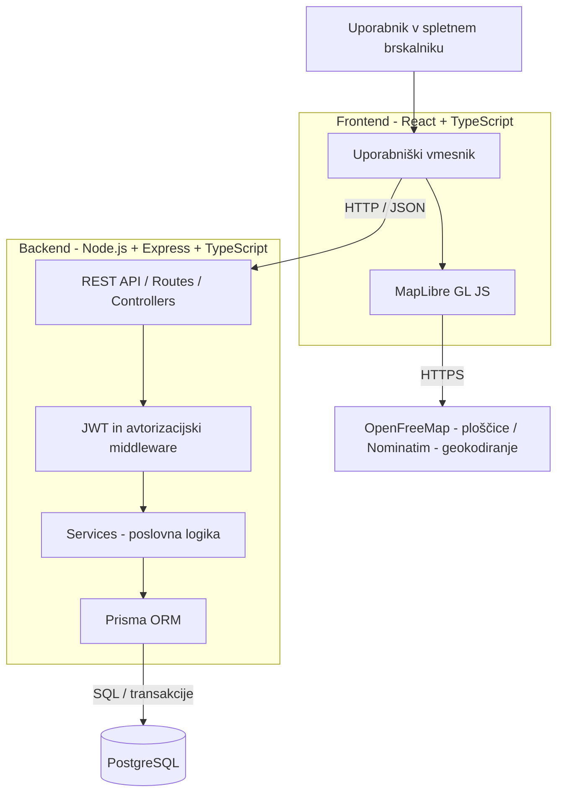

# 4. Arhitektura in tehnološki sklad – TripHarbor

## 4.1 Pregled arhitekture

TripHarbor bo razvit kot spletna aplikacija s **tridelno arhitekturo (three-tier architecture)**, ki ločuje uporabniški vmesnik, poslovno logiko in podatkovno bazo.

Sistem bo sestavljen iz treh glavnih delov:

1. **Frontend (odjemalski del):** spletna aplikacija za iskanje izletov, pregled zemljevida, prijave na izlete in upravljanje vsebin glede na uporabniško vlogo.
2. **Backend (strežniški del):** strežnik Node.js z ogrodjem Express, ki izvaja poslovno logiko, preverja uporabniške pravice, obdeluje prijave, nadzoruje kapacitete in dostopa do podatkovne baze.
3. **Podatkovna baza:** relacijska baza PostgreSQL, ki trajno shranjuje podatke o uporabnikih, destinacijah, izletih, aktivnostih in prijavah.

Frontend in backend bosta ločeni aplikaciji, ki bosta komunicirali prek **REST API-ja** z odgovori v obliki JSON. Frontend bo za prikaz zemljevida uporabljal **MapLibre GL JS**, zemljevidne ploščice **OpenFreeMap** (na podlagi podatkov OpenStreetMap) ter storitev **Nominatim** za geokodiranje lokacij.

## 4.2 Glavne komponente sistema

### Frontend

Frontend bo razvit z uporabo **React** in **TypeScript**. Za oblikovanje bo uporabljen **Tailwind CSS**, za navigacijo **React Router**, za razvojno okolje pa **Vite**.

Glavne strani oziroma moduli uporabniškega vmesnika bodo:

- **Explore:** iskanje in filtriranje izletov po destinaciji, datumu, kategoriji in zahtevnosti.
- **Map View:** interaktivni zemljevid z označenimi lokacijami objavljenih izletov.
- **Trip Details:** podrobnosti izleta, program aktivnosti, organizator in razpoložljiva mesta.
- **My Applications:** pregled lastnih prijav in njihovih statusov (ne gre za razširjeni pregled vseh preteklih izletov).
- **Organizer Dashboard:** ustvarjanje in urejanje osnutkov izletov, priprava in samodejno preverjanje programa ter obravnava prijav.
- **Admin Dashboard:** pregled in odobravanje izletov ter dodeljevanje vlog organizatorjem.
- **Authentication:** registracija, prijava, odjava in osnovno upravljanje uporabniškega računa.

Frontend bo komuniciral z backendom prek HTTP-zahtev. Prikazovanje ali skrivanje elementov glede na vlogo bo izboljšalo uporabniško izkušnjo, dejansko preverjanje dovoljenj pa bo vedno izvedeno na backendu.

### Backend

Backend bo razvit v **Node.js** z uporabo **Express** in **TypeScript**. Zasnovan bo kot **modularna monolitna aplikacija**, organizirana po funkcionalnih modulih (npr. `auth`, `users`, `trips`, `registrations`, `admin`).

V posameznih modulih bodo uporabljeni naslednji deli:

- **Routes:** določajo poti in HTTP-metode REST API-ja.
- **Controllers:** sprejemajo zahteve in oblikujejo odgovore.
- **Services:** izvajajo poslovno logiko, kot so preverjanje kapacitet, prijave in odobritve izletov.
- **Prisma ORM:** omogoča tipiziran dostop do PostgreSQL in upravljanje povezav med podatki.
- **Middleware:** preverja JWT, uporabniške vloge, dostop do virov in obravnava napake.
- **Validation:** preverja vhodne podatke z uporabo knjižnice Zod.

Backend bo preverjal vsa pomembna poslovna pravila, ne glede na preverjanja v uporabniškem vmesniku. Pred oddajo izleta v administrativni pregled bo preveril, ali so datumi aktivnosti znotraj trajanja izleta, ali imajo aktivnosti na isti dan podvojene začetne čase in ali so kronološko razvrščene. Organizatorju bo vrnil konkretna opozorila, oddajo izleta z neveljavnimi datumi pa zavrnil. Ker aktivnosti nimajo končnega časa, se v MVP ne preverja dejanskega prekrivanja njihovega trajanja. Pri potrjevanju prijav bo uporabljal podatkovne transakcije in ustrezno zaščito pred sočasnimi potrditvami, ki bi presegle kapaciteto izleta.

### Podatkovna baza

Uporabljena bo relacijska podatkovna baza **PostgreSQL**, do katere bo backend dostopal prek **Prisma ORM**.

Osnovne tabele bodo:

- `users`
- `destinations`
- `trips`
- `trip_activities`
- `registrations`

Med tabelami bodo uporabljeni primarni in tuji ključi ter omejitve, vključno z enoličnostjo e-poštnega naslova in kombinacije `trip_id` ter `user_id`. Podatkovni model je podrobneje predstavljen v tretjem dokumentu. Spremembe sheme bodo upravljane s **Prisma Migrate**.

## 4.3 Komunikacija med komponentami

Komunikacija med frontendom in backendom bo potekala prek **HTTP** v lokalnem razvoju oziroma **HTTPS** v produkcijskem okolju. Backend bo vračal podatke v obliki **JSON**.

Primeri predvidenih API-končnih točk:

| Metoda | Končna točka | Namen |
|---|---|---|
| POST | `/api/auth/register` | Registracija uporabnika |
| POST | `/api/auth/login` | Prijava uporabnika |
| GET | `/api/trips` | Iskanje in filtriranje objavljenih izletov |
| GET | `/api/trips/:id` | Podrobnosti posameznega izleta |
| POST | `/api/trips` | Ustvarjanje novega izleta |
| PATCH | `/api/trips/:id` | Urejanje lastnega osnutka izleta |
| POST | `/api/trips/:id/activities` | Dodajanje aktivnosti v program izleta |
| POST | `/api/trips/:id/validate-program` | Preverjanje skladnosti programa in prikaz opozoril |
| POST | `/api/trips/:id/submit` | Oddaja izleta v administrativni pregled po preverjanju programa |
| POST | `/api/trips/:id/registrations` | Prijava uporabnika na izlet |
| PATCH | `/api/registrations/:id/cancel` | Preklic lastne prijave |
| GET | `/api/trips/:id/registrations` | Pregled prijav za organizatorja izleta |
| PATCH | `/api/registrations/:id/status` | Sprejem ali zavrnitev prijave |
| GET | `/api/admin/trips/pending` | Pregled izletov, ki čakajo na odobritev |
| PATCH | `/api/admin/trips/:id/approval` | Odobritev ali zavrnitev objave |
| PATCH | `/api/admin/users/:id/role` | Dodelitev vloge organizatorja |

Končne točke predstavljajo **načrtovani API** in se lahko med implementacijo podrobneje prilagodijo. Dodelitev vloge organizatorja bo v MVP potekala ročno prek administrativnega vmesnika; samostojen sistem zahtevkov in njihovega sledenja ni predviden.

### Primer poteka prijave na izlet

1. Udeleženec odpre podrobnosti objavljenega izleta in izbere možnost prijave.
2. Frontend pošlje zahtevo REST API-ju.
3. Middleware na backendu preveri veljavnost JWT in identiteto uporabnika.
4. Service preveri, ali je izlet objavljen, ali so prijave še odprte in ali uporabnik že ima prijavo.
5. Če prijava še ne obstaja, sistem ustvari zapis s statusom `PENDING`. Če obstaja preklicana prijava, posodobi njen status iz `CANCELLED` v `PENDING`. Ponovna prijava po zavrnitvi (`REJECTED`) ni samodejno dovoljena.
6. Organizator pregleda prijavo in jo sprejme ali zavrne.
7. Ob potrditvi backend v **podatkovni transakciji** preveri število že sprejetih prijav in kapaciteto izleta. Sočasne potrditve morajo biti usklajene tako, da ne morejo preseči omejitve.
8. Prisma shrani posodobljeni status v PostgreSQL, frontend pa prikaže rezultat.

Udeleženec lahko prijavo prekliče, s čimer se njen status spremeni v `CANCELLED`. Če je bila prijava prej potrjena, se mesto sprosti. Pri ponovni prijavi se uporabi isti zapis, saj kombinacija `trip_id` in `user_id` ostane enolična.

## 4.4 Diagram arhitekture



Diagram prikazuje komunikacijo med uporabniškim vmesnikom, backendom, podatkovno bazo in geografskimi storitvami. Pri uporabi javne storitve **Nominatim** bodo upoštevane omejitve zahtev, pravila uporabe in zahteve glede identifikacije odjemalca; za večji obseg uporabe bo potrebna ustrezna gostovana storitev. Geokodiranje se lahko po potrebi izvaja prek backenda, da se omogočita predpomnjenje in nadzor nad številom zahtev.

## 4.5 Avtentikacija in avtorizacija

Za avtentikacijo bodo uporabljeni **JWT (JSON Web Token)**, za varno zgoščevanje gesel **bcrypt**, za preverjanje dostopa pa **Express middleware**.

Predviden način delovanja:

1. Uporabnik se registrira z e-poštnim naslovom in geslom.
2. Backend preveri podatke in geslo pred shranjevanjem zgosti z algoritmom BCrypt.
3. Ob uspešni prijavi backend izda časovno omejen dostopni žeton JWT.
4. Frontend žeton pošilja v glavi `Authorization: Bearer <token>` pri zaščitenih zahtevah.
5. Backend preveri podpis in veljavnost žetona ter aktualno stanje uporabniškega računa in vlogo iz podatkovne baze.
6. Middleware in poslovna logika preverita tudi lastništvo izleta oziroma prijave, kadar je to potrebno.

Sistem bo podpiral tri uporabniške vloge:

- `PARTICIPANT`
- `ORGANIZER`
- `ADMIN`

Ob registraciji uporabnik pridobi vlogo `PARTICIPANT`. Vlogo `ORGANIZER` lahko administrator na zahtevo uporabnika dodeli ročno prek administrativnega vmesnika. Vloga `ADMIN` se dodeljuje samo prek nadzorovanega administrativnega postopka, ne prek javne registracije.

Organizator lahko ureja samo svoje osnutke izletov in upravlja prijave na svoje izlete. Administrator odobrava objave in dodeljuje vloge, ne prevzema pa običajnega odločanja o prijavah namesto organizatorja.

Dostopni JWT bodo kratkoživi in shranjeni v pomnilniku odjemalca. Ob odjavi se žeton odstrani. Za daljše prijavne seje bo mogoče kasneje dodati osvežitvene žetone v zaščitenih piškotkih `HttpOnly`, `Secure` in `SameSite`. V produkcijskem okolju bo obvezna uporaba HTTPS.

## 4.6 Tehnološki sklad

| Področje | Tehnologija / orodje | Namen |
|---|---|---|
| Frontend | React | Izdelava interaktivnega uporabniškega vmesnika |
| Programski jezik | TypeScript | Tipizirana koda na frontendu in backendu |
| Oblikovanje | Tailwind CSS | Odziven uporabniški vmesnik |
| Navigacija | React Router | Prehajanje med stranmi aplikacije |
| Razvojno okolje frontenda | Vite | Lokalni razvoj in gradnja frontenda |
| Backend | Node.js + Express | REST API in poslovna logika |
| Avtentikacija in avtorizacija | JWT + bcrypt + Express middleware | Prijava, varno shranjevanje gesel in nadzor dostopa |
| Validacija podatkov | Zod | Preverjanje vhodnih podatkov |
| Dostop do podatkov | Prisma ORM | Tipizirane poizvedbe in relacije med entitetami |
| Podatkovna baza | PostgreSQL | Trajno shranjevanje podatkov |
| Migracije baze | Prisma Migrate | Upravljanje sprememb podatkovne sheme |
| Zemljevid | MapLibre GL JS | Interaktivni prikaz lokacij izletov |
| Geografske storitve | OpenFreeMap in Nominatim (OpenStreetMap) | Zemljevidne ploščice in geokodiranje |
| Lokalni razvoj | Docker Compose | Zagon podatkovne baze |
| Razvojna orodja | VS Code | Pisanje kode in odpravljanje napak |
| Testiranje API-ja | Postman  | Preverjanje API-končnih točk |
| Verzijsko upravljanje | Git + GitHub | Upravljanje različic kode |

## 4.7 Lokalni razvoj in zagon

Predvidena struktura projekta:

```text
TripHarbor/
├── frontend/
│   ├── public/
│   ├── src/
│   ├── package.json
│   └── vite.config.ts
├── backend/
│   ├── prisma/
│   │   ├── schema.prisma
│   │   └── migrations/
│   ├── src/
│   │   ├── modules/
│   │   │   ├── auth/
│   │   │   ├── users/
│   │   │   ├── trips/
│   │   │   ├── registrations/
│   │   │   └── admin/
│   │   ├── middleware/
│   │   ├── lib/
│   │   ├── app.ts
│   │   └── server.ts
│   ├── package.json
│   ├── tsconfig.json
│   └── .env.example
├── docs/
│   ├── 01-zasnova-resitve.md
│   ├── 02-funkcionalnosti-in-obseg.md
│   ├── 03-podatkovni-model.md
│   └── 04-arhitektura-in-tehnoloski-sklad.md
├── compose.yaml
└── README.md
```

Za lokalni zagon bodo potrebni:

- Node.js (podprta različica LTS) in npm,
- Docker z Docker Compose,
- Git.

**Predvideni postopek lokalnega zagona:**

1. Prenos projekta iz repozitorija Git.
2. Nastavitev okoljskih spremenljivk v `backend/.env`, predvsem `DATABASE_URL` za povezavo s PostgreSQL in `JWT_SECRET` za podpisovanje žetonov. Dejanske skrivnosti ne bodo vključene v Git.
3. Zagon PostgreSQL v korenski mapi projekta z ukazom `docker compose up -d`.
4. Prehod v mapo `backend` in namestitev odvisnosti z `npm install`.
5. Izvedba migracij z `npx prisma migrate dev` (pri prvem lokalnem zagonu oziroma ob spremembi sheme).
6. Zagon backenda z `npm run dev`.
7. V ločenem terminalu prehod v mapo `frontend` in namestitev odvisnosti z `npm install`.
8. Zagon frontenda z `npm run dev`.
9. Dostop do aplikacije na naslovu `http://localhost:5173`.

Backend bo predvidoma dostopen na naslovu `http://localhost:3000`. Skripta `npm run dev` bo definirana v `package.json` posamezne aplikacije. Med lokalnim razvojem bo omogočen ustrezno omejen CORS oziroma Vite proxy za povezavo med frontendom in backendom.

Podatki bodo shranjeni v trajnem Docker volumnu, zato se ob ponovnem zagonu vsebnika ne bodo izgubili. Spremembe podatkovne sheme bodo sledljive prek migracij Prisma.

## 4.8 Arhitekturne odločitve in utemeljitve

Pri izbiri tehnologij sem upoštevala predvsem obseg projekta, samostojen razvoj, povezane podatke in potrebo po preglednem upravljanju uporabniških vlog, izletov ter prijav. Izbrane rešitve omogočajo izvedbo MVP brez nepotrebno zapletene infrastrukture.

| Odločitev | Zakaj sem jo izbrala za TripHarbor |
|---|---|
| Tridelna arhitektura | Ker aplikacija vključuje različne uporabniške vloge in poslovna pravila, želim ločiti prikaz izletov od preverjanja prijav, odobritev in podatkovne baze. Tako lahko posamezne dele spreminjam brez poseganja v celoten sistem. |
| Ločen frontend in backend | Uporabniški vmesnik za udeležence, organizatorje in administratorje se bo razvijal drugače kot poslovna logika. Ločitev mi omogoča, da funkcionalnosti preverjam prek API-ja tudi brez dokončanega uporabniškega vmesnika. |
| React + TypeScript | React sem izbrala, ker bo aplikacija vsebovala več interaktivnih strani, filtre, obrazce, zemljevid in nadzorne plošče, pri katerih lahko ponovno uporabim komponente. TypeScript mi pomaga zmanjšati napake pri prenosu podatkov o izletih in prijavah med komponentami. |
| Tailwind CSS + React Router + Vite | Tailwind sem izbrala za hitrejše in enotnejše oblikovanje različnih pogledov. React Router potrebujem za jasno ločene strani izletov in nadzorne plošče posameznih vlog, Vite pa za preprost in hiter lokalni razvoj React aplikacije. |
| Node.js + Express + TypeScript | Izbrala sem jih, ker lahko uporabljam TypeScript na obeh straneh aplikacije in se osredotočim na izvedbo REST API-ja, preverjanje vlog ter proces prijav, namesto na učenje dodatnega programskega jezika. Express mi daje dovolj prilagodljivosti brez kompleksnejšega ogrodja. |
| Modularni monolit | Ker projekt razvijam samostojno in ima omejen obseg, bi mikrostoritve povzročile nepotrebno zahtevnost. Module za uporabnike, izlete, prijave in administracijo lahko vseeno ločim v pregledno strukturo. |
| PostgreSQL | Izbrala sem relacijsko bazo, ker so uporabniki, destinacije, izleti, aktivnosti in prijave močno povezani. Tuji ključi in transakcije so posebej pomembni pri preprečevanju podvojenih prijav in prekoračitve kapacitet. |
| Prisma ORM | Izbrala sem ga zaradi več povezanih entitet in uporabe TypeScripta. Tipiziran dostop do podatkov mi olajša delo z relacijami med izleti, aktivnostmi in prijavami ter zmanjša količino ročno napisanih SQL-poizvedb. |
| Prisma Migrate | Ker se bo podatkovni model med razvojem lahko dopolnjeval, želim imeti spremembe sheme zapisane v migracijah, da lahko bazo ponovno vzpostavim in sledim spremembam skupaj s kodo. |
| JWT + bcrypt + Express middleware | Aplikacija ima tri vloge z različnimi pravicami, zato potrebujem preverjanje identitete pri zaščitenih API-zahtevah. JWT sem izbrala za dostopne žetone, bcrypt za varno shranjevanje gesel, middleware pa za enotno preverjanje dostopa. |
| Zod | Ker bodo organizatorji vnašali datume, kapacitete in podatke o aktivnostih, želim neveljavne vnose zavrniti že ob sprejemu API-zahtev. Dodatno preverjanje skladnosti celotnega programa bo izvedeno v storitvenem sloju, kjer lahko primerjam več aktivnosti med seboj. |
| MapLibre GL JS + OpenFreeMap + Nominatim | Zemljevid je ena ključnih funkcionalnosti TripHarbora. Te rešitve sem izbrala, ker omogočajo prikaz destinacij in iskanje geografskih lokacij brez razvoja lastnega zemljevidnega sistema; pri uporabi javnih storitev bom upoštevala njihove omejitve. |
| REST API + JSON | Ker sta frontend in backend ločena, sem izbrala preprost in razširjen način komunikacije, ki ga lahko med razvojem neposredno preverjam tudi s Postmanom. |
| Docker Compose | Izbrala sem ga, da lahko PostgreSQL lokalno zaženem z enako konfiguracijo in trajnim shranjevanjem podatkov, ne da bi bazo vsakič ročno nameščala. |

## 4.9 Varnost in razširljivost

Pri razvoju bodo upoštevana naslednja načela:

- Preverjanje identitete, uporabniških vlog in lastništva podatkov na strežniški strani.
- Varno zgoščevanje gesel z BCrypt.
- Validacija vhodnih podatkov z Zod in dodatno preverjanje poslovnih pravil.
- Uporaba HTTPS v produkcijskem okolju.
- Varovanje gesel, skrivnosti in povezovalnih nizov z okoljskimi spremenljivkami.
- Omejen CORS in ustrezna obravnava napak brez razkrivanja občutljivih podatkov.
- Preprečevanje podvojenih prijav z enolično omejitvijo `trip_id` in `user_id`.
- Preprečevanje prekoračitve kapacitet z ustrezno transakcijsko zaščito pri sočasnem potrjevanju prijav.
- Omejitev dostopa do osebnih podatkov glede na uporabniško vlogo.
- Upoštevanje omejitev in pogojev uporabe zunanjih geografskih storitev.

Arhitektura bo omogočala kasnejše dodajanje obvestil, ocen, priljubljenih izletov, skupinskega klepeta in personaliziranih priporočil brez popolne prenove osnovnega sistema.
