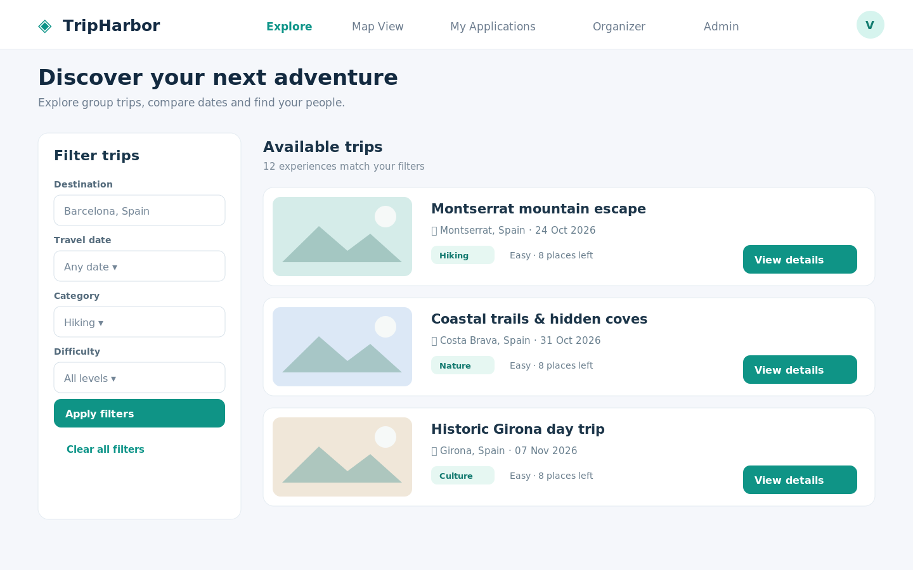
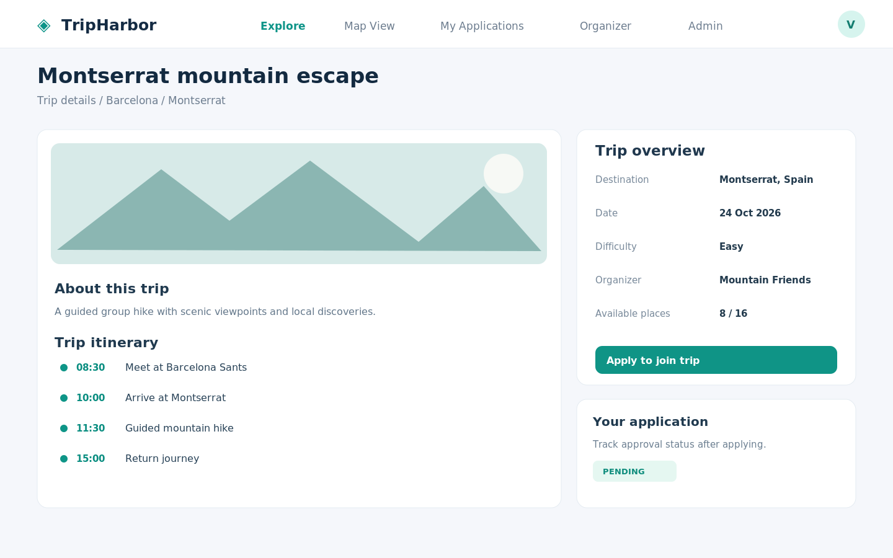
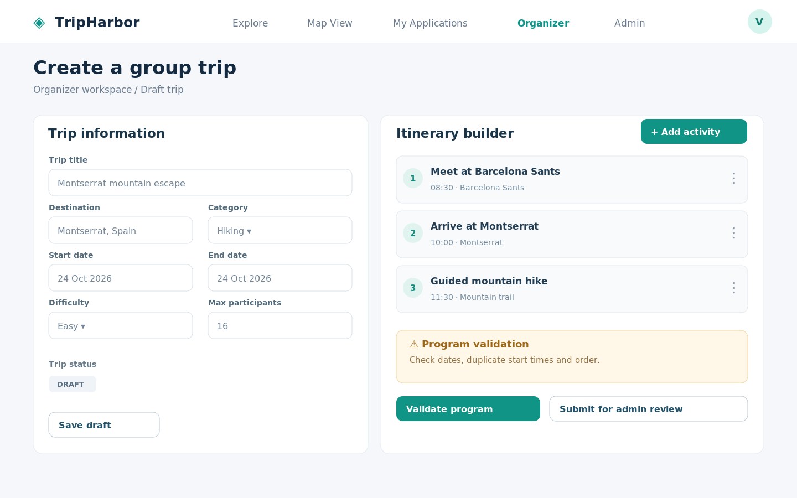
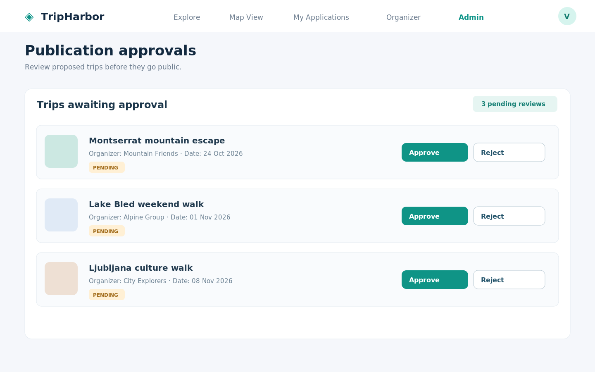

# 6. Wireframes – TripHarbor

## 6.1 Namen in pregled

V nadaljevanju so predstavljeni štirje žični modeli (*wireframes*) spletne aplikacije **TripHarbor**. Prikazujejo predvideno razporeditev glavnih elementov uporabniškega vmesnika za udeleženca, organizatorja in administratorja. Modeli so zasnovani za namizni pogled in služijo kot izhodišče za kasnejšo implementacijo v Reactu.

Prikazani so **konceptualni zasloni**, zato ne predstavljajo že implementirane aplikacije. Barve in primeri izletov so ilustrativni.

## 6.2 Wireframe 1 – Iskanje in filtriranje izletov (Explore)

**Opis:** Začetni pogled prikazuje iskalnik in filtre za destinacijo, datum, kategorijo in zahtevnost ter seznam razpoložljivih izletov. Vsaka kartica vsebuje osnovne informacije in gumb za pregled podrobnosti. Navigacija vključuje tudi dostop do zemljevida.

**Povezane uporabniške zgodbe:** `US-01` (iskanje in filtriranje), `US-02` (prehod na zemljevid). **Obseg:** MVP.

## 6.3 Wireframe 2 – Podrobnosti izleta in prijava (Trip Details)

**Opis:** Stran posameznega izleta prikazuje opis, program aktivnosti po urah, destinacijo, datum, zahtevnost, organizatorja in število prostih mest. Prijavljen uporabnik lahko odda prijavo, nato pa spremlja njen status. Prikazani status `PENDING` ponazarja stanje po uspešni oddaji prijave.

**Povezane uporabniške zgodbe:** `US-05` (prijava na izlet), del `US-03` (prikaz načrtovanega programa). **Obseg:** MVP.

## 6.4 Wireframe 3 – Priprava izleta in preverjanje programa (Organizer Dashboard)

**Opis:** Organizator vnese osnovne podatke o izletu in pripravi program aktivnosti z začetnimi časi in lokacijami. Z gumbom **Validate program** sproži preverjanje datumov, podvojenih začetnih časov in kronološkega vrstnega reda. Ob napakah prejme opozorila; izleta z neveljavnimi datumi ni mogoče poslati administratorju. Osnutek lahko shrani tudi pred dokončnim preverjanjem.

**Povezane uporabniške zgodbe:** `US-03` (priprava izleta in programa), `US-04` (samodejno preverjanje skladnosti). **Obseg:** MVP.

## 6.5 Wireframe 4 – Odobritev objave izleta (Admin Dashboard)

**Opis:** Administrator vidi seznam izletov s statusom `PENDING`, njihove osnovne podatke in organizatorje. Posamezen izlet lahko odobri ali zavrne. Ob odobritvi se status izleta spremeni v `PUBLISHED`, ob zavrnitvi pa v `REJECTED`. Odločanje o prijavah udeležencev ostaja naloga organizatorja.

**Povezana uporabniška zgodba:** `US-07` (odobritev objave izleta). **Obseg:** MVP.

## 6.6 Povezava z MVP in nadaljnjim razvojem

| Wireframe | Glavni namen | Povezane zgodbe |
|---|---|---|
| 01 – Explore | Iskanje, filtriranje in odkrivanje izletov | `US-01`, `US-02` |
| 02 – Trip Details | Pregled programa in prijava na izlet | `US-05` |
| 03 – Organizer Dashboard | Ustvarjanje izleta, načrtovanje in preverjanje programa | `US-03`, `US-04` |
| 04 – Admin Dashboard | Odobritev ali zavrnitev objave | `US-07` |

Wireframe-i pokrivajo ključne korake poslovnega procesa: **priprava izleta → preverjanje programa → administrativna odobritev → iskanje izleta → prijava udeleženca**. Upravljanje prijav in kapacitet (`US-06`) je del MVP, vendar zanj v tej fazi ni izdelan ločen wireframe; zaslon bo načrtovan pri podrobnejši implementaciji organizatorjeve nadzorne plošče.
